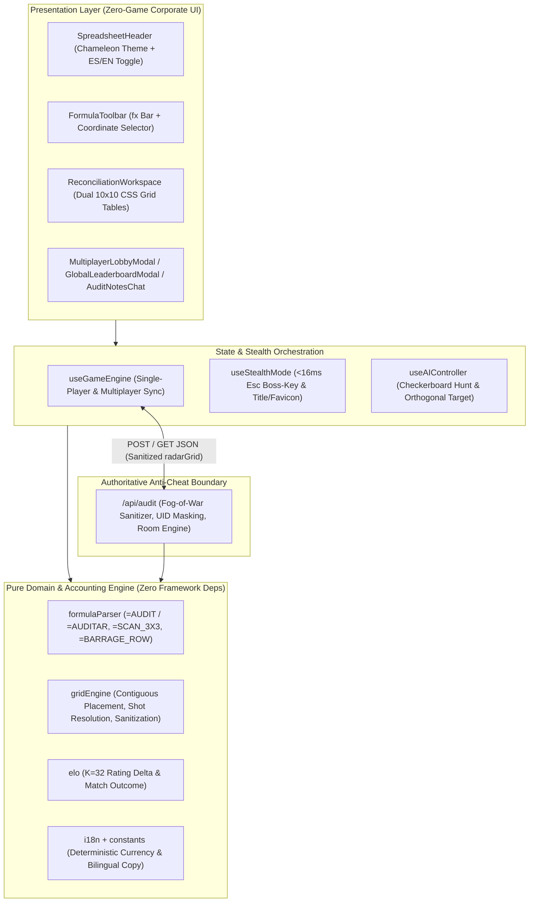

# RECON-Q4 — Cloud Spreadsheet Reconciliation Tool

[](https://github.com/iwantdeveverything/office-battleship/actions/workflows/ci.yml)
[](./LICENSE)
[](./tsconfig.json)
[](./AGENTS.md)

**RECON-Q4** is a bilingual (`es` / `en`) real-time tactical Battleship application disguised 100% as an enterprise financial reconciliation spreadsheet (**Google Sheets**, **Microsoft Excel 365**, and **JetBrains DataGrip SQL Dark Mode**). It enforces server-side Fog-of-War anti-cheat (`/api/audit`), `<16ms` zero-layout-shift (`CLS = 0`) Boss-Key Panic Mode, and spreadsheet formula-bar execution (`=AUDIT(E5)` / `=AUDITAR(E5)`).

---

## Quick Path

1. **Install & Run Dev Server:**
   ```bash
   npm ci
   npm run dev
   ```
2. **Run Unit, Formula & Anti-Cheat Tests (`14/14`):**
   ```bash
   npm test
   ```
3. **Verify Strict TypeScript & Production Build:**
   ```bash
   npm run typecheck
   npm run build
   ```

---

## Engineering & Architectural Philosophy

RECON-Q4 is built around five non-negotiable engineering pillars enforced continuously via [`AGENTS.md`](./AGENTS.md) and [`.gga`](./.gga):

| Pillar | Problem Solved | Architectural Decision |
| :--- | :--- | :--- |
| **1. Screaming Domain Architecture** | Framework-coupled game state becomes untestable and leaks UI concerns into business rules. | Pure domain contracts ([`src/types/game.ts`](src/types/game.ts)), deterministic math ([`src/lib/elo.ts`](src/lib/elo.ts)), and grid/formula engines ([`src/lib/gridEngine.ts`](src/lib/gridEngine.ts), [`src/lib/formulaParser.ts`](src/lib/formulaParser.ts)) have **zero React or Next.js imports**. |
| **2. Zero-Game Corporate Disguise** | Traditional "stealth games" fail visual inspection because of canvas sprites, arcade fonts, or gaming nouns (`ship`, `bomb`, `enemy`). | Every user-facing string uses strict accounting terminology (`Ledger`, `Account`, `Audit`, `Discrepancy`, `Liquidated`). Status indicators render as native spreadsheet validation pills (`#VALUE!`, `#REF!`, `OK`, `PENDING`). |
| **3. Server-Side Fog-of-War Trust Boundary** | Client-side multiplayer Battleship leaks opponent coordinates via browser DevTools Network inspection. | [`src/app/api/audit/route.ts`](src/app/api/audit/route.ts) acts as an authoritative referee: it validates contiguous/collinear fleet geometry on submission, masks player tokens (`REDACTED_P1` / `REDACTED_P2`), and strips un-audited opponent `shipId`/`shipCode` cells before serializing `radarGrid`. |
| **4. `<16ms` `CLS = 0` Panic Mode** | Page redirects or conditional layout swaps cause visible flicker and Cumulative Layout Shift (`CLS > 0`) when pressing `Esc`. | [`src/hooks/useStealthMode.ts`](src/hooks/useStealthMode.ts) mutates cell text in-place within the existing `<table role="grid">` DOM structure using deterministic coordinates (`getDeterministicCurrency` in [`src/lib/constants.ts`](src/lib/constants.ts)), updating the document title (`* Q4_Financial_Reconciliation...`) and SVG spreadsheet favicon in a single frame. |
| **5. True Bilingual Parity (`es` / `en`)** | Hardcoded strings or single-locale parsers break international usability. | UI chrome switches instantaneously via [`src/lib/i18n.ts`](src/lib/i18n.ts), while [`src/lib/formulaParser.ts`](src/lib/formulaParser.ts) accepts **both** English and Spanish spreadsheet formulas simultaneously regardless of active UI locale. |

### System Architecture



---

## Spreadsheet Formula Reference (`fx`)

Type any formula into the `fx` bar and press `Enter` during an active audit:

| Tactical Action | English Formula | Spanish Formula | Constraint / Cooldown |
| :--- | :--- | :--- | :--- |
| **Single Cell Audit** | `=AUDIT(E5)` | `=AUDITAR(E5)` | Standard turn action (`A1`–`J10`) |
| **3x3 Regional Scan** | `=SCAN_3X3(C4)` | `=ESCANEAR_3X3(C4)` | 1 use per match (`B2`–`I9` center) |
| **Full Row Barrage** | `=BARRAGE_ROW(3)` | `=BARRIDO_FILA(3)` | Requires **3 consecutive hits** streak |

---

## Account Ledger Structure (Fleet)

| Code | English Account Name | Spanish Account Name | Cells |
| :--- | :--- | :--- | :---: |
| `OFT` | Offshore Trust | Fideicomiso Offshore | `5` |
| `VCS` | Venture Capital Syndicate | Sindicato Capital Riesgo | `4` |
| `SHC` | Shell Holding Corp | Corporación Holding | `3` |
| `SLF` | Slush Fund | Fondo Reservado | `3` |
| `PTC` | Petty Cash | Caja Chica | `2` |

---

## Verification Checklist

- [x] `Esc` toggles Panic Mode in `<16ms` with deterministic currency values and `CLS = 0`.
- [x] `R` rotates account placement orientation (`H` / `V`) during setup.
- [x] `Enter` in the `fx` formula bar executes `=AUDIT` / `=AUDITAR`, `=SCAN_3X3` / `=ESCANEAR_3X3`, and `=BARRAGE_ROW` / `=BARRIDO_FILA`.
- [x] `/api/audit` enforces strict Fog-of-War, contiguous fleet geometry, UID masking, and `K = 32` ELO rating updates.
- [x] Disguised multiplayer room links (`/spreadsheets/d/[roomId]/edit`) auto-join or provision rooms seamlessly.

---

## License

Licensed under the [GNU General Public License v2.0 (GPL-2.0-only)](./LICENSE).
